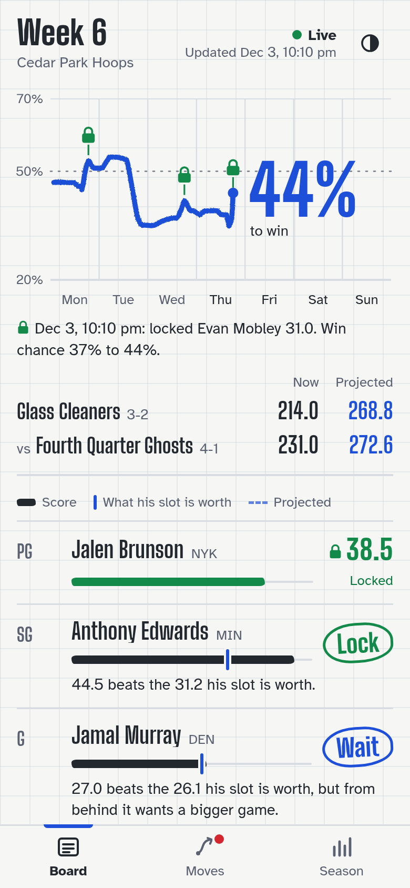
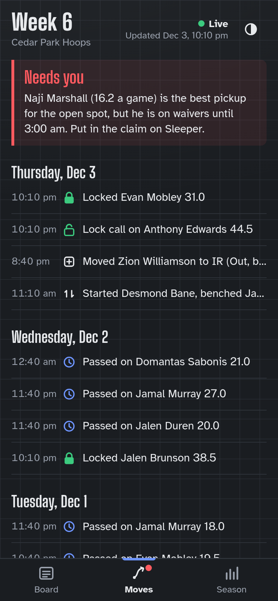
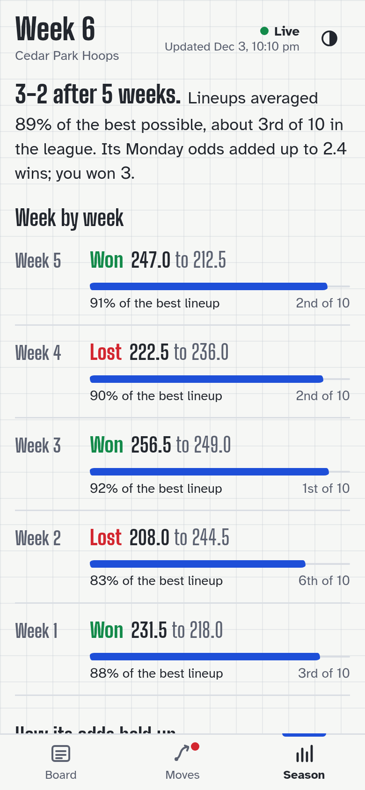

# sleeper-gm

An automated manager for **Sleeper fantasy basketball in Lock-In mode**. It locks the right games,
sets your lineup before every tip, keeps your IR legal, and picks up free agents, choosing each
move by how much it raises your chance of winning this week's matchup. It runs on its own every
30 minutes, sends you what it did, and comes with a phone app and an MCP server so Claude (or any
MCP client) can read your matchup and explain its calls.

<p align="center">
  
  
  
</p>

> Unofficial. Not affiliated with Sleeper. Sleeper's [terms](https://support.sleeper.com/en/articles/5486620-general-terms-of-use)
> (section 11.1) prohibit automated access without their written consent, and the manager acts
> through your own session token. Using it is your decision and your account's risk. It ships with
> writes switched off.

## Why Lock-In needs a manager

In Lock-In each starter counts **one game a week**. After a game ends you may lock it until that
player's next tip; if you never lock, his team's **final** game of the week counts, zero if he sits.
A bench game never counts. So every open slot is a stopping problem: take tonight's 31, or keep the
slot open for a better game later in the week, knowing the last one is forced. Most people decide
by feel and lock too early or too late; Sleeper itself reports each week's hindsight maximum, and the
gap is usually large.

## How it decides

1. **Projections.** Each remaining game is a distribution, not a number: projected minutes times
   per-minute production (recency-weighted, shrunk toward last season), a per-player spread fitted
   for the upper tail, and the chance he plays, from his injury status, the last game he played or
   sat, back-to-backs and ESPN's expected return date. A walk-forward backtest on 22,408 player-games
   (no game ever sees its own result): mean error 5.1 fantasy points a game; the 90th-percentile line
   covers 92.7% of real games (target 90%). Details in `sleeper-gm backtest`.
2. **Open value of every slot.** Each available player is bound to at most one open slot for the rest
   of the week and each slot's stopping problem is solved backward over its players' games: the value
   of keeping it open is E[max(tonight, what comes after)], with the forced final game and the chance
   he sits. For a 30-a-game player (spread 10, plays 97%) with two games left, that line is 33.4,
   the textbook optimal-stopping answer; the tests check it.
3. **Win probability, not points.** A finished game is locked when it beats its slot's open value, then
   every decision is flipped in a Monte Carlo of the rest of the week (8,000 paths, common random
   numbers so two alternatives differ only where their decisions differ) against a model of your
   opponent, and any flip that raises the chance of winning by a point is taken. Ahead, it locks
   safer; behind, it holds out for a ceiling game.
4. **Lineup.** Before each tip the players planned for today take their slots, a player being locked
   moves to the most specific slot he fits (so G, F and UTIL stay open), and nobody plays an
   unplanned game in a starting slot.
5. **The crowd, for context only.** For every game it could lock, it reads that game's public Sleeper
   discussion and shows the split ("Sleeper chat: 75% lock, 8 votes") plus any availability news next
   to its own call. It never follows the crowd; it only shows it.
6. **Roster.** A healthy player left on IR freezes the lineup in Sleeper's apps, so that is fixed first.
   Empty spots get the free agent who adds most to this week's win chance plus rest-of-season value;
   swaps need a 3-point edge. Pickups must be in a real rotation right now. Your best players, anyone
   locked, mid-game or holding a lockable game are never dropped. Trades are never sent.

Slots are solved over distinct **tip events**, so an early game and a late game can both be looks
on the same day. The model reserves **150 minutes** for a game (15 beyond a typical 2h15),
**10 minutes** for the box feed, then waits for the first scheduled **:10/:40** run, with at least
**10 minutes** before the next tip. A 7pm look can therefore hand off at 9:40pm to a 10pm look;
an 8pm look cannot follow it. These are `GAME_SPAN`, `BOX_DELAY` and `LEAD` in `policy.py`.

Timing is uncertain: the model gives each potential same-day handoff a **90%** normal branch
and a **10%** delayed branch that misses the remaining looks that day. This is a conservative
assumption, not a measured completion rate; delay and scoring are modeled independently. The
DP, risk-plan realization and Monte Carlo follow the same branches, with separate continuation
bars after a timely or delayed final. Runtime still requires a completed game and its box feed;
an unresolved game waits for another run. A terminal draw is forced, including a zero for a DNP.
The opponent retains one look per day.

`status`, the daily brief and the Board show each open slot's ordered plan and lock bars.
Later looks require passing the earlier scores and keeping the slot open. `now.json` adds
`plan: {looks, expected_value}` to open slot rows and `role` to bench players, preserving existing
fields. Each look has `id`, `name`, Eastern `date`, `tip_ms`, `lock_above`, `terminal` and
`handoff_p`. The bar is the normal branch's continuation value, not a promise to lock regardless
of matchup context; `terminal: true` means the final draw counts even below the bar. Bench roles
identify planned games or reserves without promising an injury substitution the policy did not model.

## Safety rails

- Writes are **off** until you run `sleeper-gm on`, and a run only writes when it is also asked to.
- One roster change at a time, then a fresh read of the real roster. Writes are never retried (a write
  that timed out may have gone through); state is re-read instead. Every write is read back.
- Lock windows and tip times are re-checked right before every lineup save. A lock it cannot prove is
  legal is sent on its own, and a refusal is remembered.
- Max 2 transactions a day per league (IR-forced drops included). Waiver claims are never submitted.
- Your token, config, logs and data never live in this repo: `~/.config/sleeper-gm`,
  `~/.local/state/sleeper-gm`, `~/.cache/sleeper-gm`.

## Install

Python 3.10+.

```
pip install "sleeper-gm[mcp] @ git+https://github.com/javiirf/sleeper-gm"
```

Log in once. In a browser logged into sleeper.com open DevTools, Application, Local Storage,
`https://sleeper.com`, copy the value of `token`, then:

```
sleeper-gm login          # paste it (input hidden); saved 0600
sleeper-gm leagues        # which leagues it will manage (in-season, Lock-In, yours)
sleeper-gm status         # read-only: win chance, every slot, what it would do
```

The token grants full access to your Sleeper account. Treat it like a password.

## Let it run

```
sleeper-gm on                     # allow changes
sleeper-gm schedule install       # every 30 min at :10 and :40 (systemd, launchd or cron)
```

Each scheduled run makes one cheap check and exits when nothing is happening; the first run after
09:30 US Eastern sends the daily brief (Mondays also last week's review). `sleeper-gm off` stops all
changes at once; `sleeper-gm schedule remove` stops the schedule.

Notifications go wherever you point them in `~/.config/sleeper-gm/config.json`:

```json
{ "notify": { "ntfy_topic": "my-secret-topic" } }
```

or `"telegram_chat_id"` with `SLEEPER_GM_TELEGRAM_TOKEN` set, or `"command"`: any program that
reads the message on stdin.

## The phone app

```
sleeper-gm web            # http://127.0.0.1:8770, read-only, no Sleeper access of its own
sleeper-gm web --demo     # the demo league in the screenshots
```

It binds to localhost and shows your league, so keep it private. With Tailscale:
`tailscale serve --bg --https=8448 http://127.0.0.1:8770`, open it on your phone and use
Add to Home Screen. Board: this week's win-chance line and every slot's call. Moves: every lock,
pass and pickup with the reason. Season: results, share of the best possible lineup, and how its
win chances held up.

## MCP server

```
claude mcp add sleeper-gm -- sleeper-gm mcp
```

Claude Desktop: add `{"command": "sleeper-gm", "args": ["mcp"]}` under `mcpServers`.

| Tool | What it does |
|---|---|
| `list_leagues` | Your NBA leagues and whether the manager handles them |
| `matchup` | Win chance, both teams, every slot, and what it would do now |
| `player_outlook` | A player's remaining games: chance he plays, mean, 10th/90th percentile, injury, return date |
| `decision_log` | Every run this week: win chance, locks, passes, actions |
| `week_review` | A finished week vs Sleeper's hindsight maximum |
| `run_manager` | One cycle; changes Sleeper only with `live=true` and `sleeper-gm on` |

## Config

`~/.config/sleeper-gm/config.json` (all optional):

| Key | Default | Meaning |
|---|---|---|
| `leagues` | `"auto"` | every in-season Lock-In league you own, or a list of league ids |
| `live` | `false` | set by `sleeper-gm on` / `off` |
| `moves` | `true` | free-agent adds and swaps |
| `max_transactions_per_day` | `2` | per league |
| `protect_top` | `8` | never drop your best N |
| `protect_ros` | `30.0` | never drop anyone worth this many points a game |
| `brief_at_et` | `"09:30"` | daily brief time, US Eastern |
| `web_url` | `null` | your private link to the phone app, added to each brief |
| `notify` | | `command`, `telegram_chat_id`, `ntfy_topic` |

## Limits

- Lock-In leagues only (Sleeper's default for new NBA leagues). Game Pick and other modes are skipped.
- The opponent model keeps their lineup and subs only for a starter who will not play.
- Game-level lock eligibility is checked against the lineups it has seen; a change you make by hand
  between runs is seen at the next run.
- Sleeper can change its private API at any time.

## Development

```
git clone https://github.com/javiirf/sleeper-gm && cd sleeper-gm
python -m venv .venv && .venv/bin/pip install -e ".[dev,mcp,browser]"
.venv/bin/pytest -q
```

`AGENTS.md` has the league rules and API facts the code depends on.

## Credits

The lineup and lock mutation shapes were confirmed against the open-source
[sleeper-chrome-extension](https://github.com/louhow/sleeper-chrome-extension) and the
[sleeper-mcp API notes](https://github.com/bealmot/sleeper-mcp/blob/main/API-NOTES.md). Availability
rates by injury designation from [isheplayingtonight](https://isheplayingtonight.com/nba-injuries/questionable-play-rate);
within-week DNP persistence from [sleeper-lineup](https://github.com/ckloote/sleeper-lineup).

MIT license.
